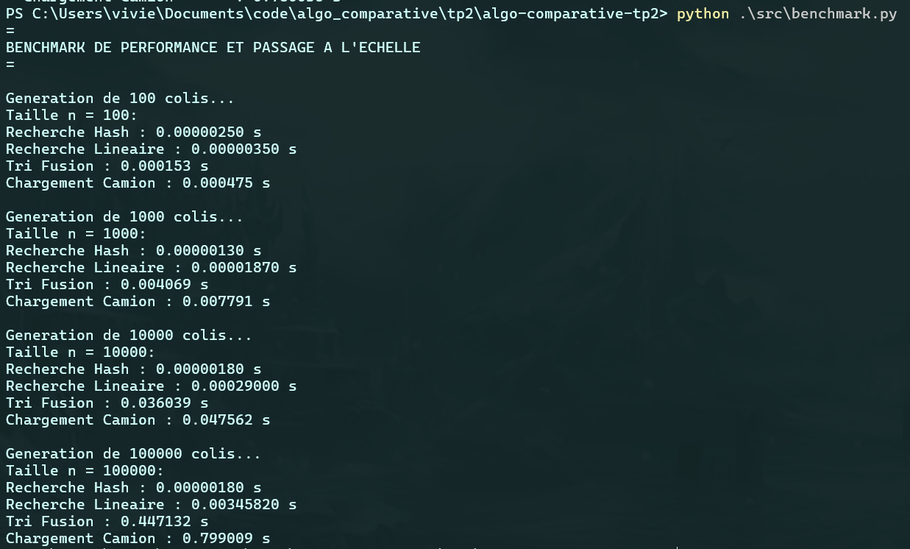
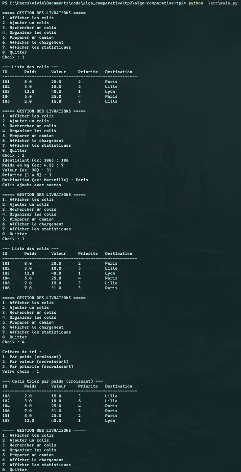

# Rapport de Projet : Algorithmique Comparative et Optimisation de Chargement

## 1. Choix de la structure de données pour la collection de colis

La gestion d'un volume pouvant atteindre un nombre important de 100 000 colis, on besoin tantot de pouvoir parcourir rapidement tout le volume, tantot acceder frequement par identifiant. Cela est a evité avec un simple tableau dynamique.
Afin de resoudre ce probleme, on utilise une structure hybride combinant un tableau dynamique et une table de hachage.
La table de hachage fait le liens entre l'id du colis et l'addresse colis et la liste contient uniquement l'addresse.
La table de hachage permet d'avoir une recherche par index d'une complexité temporel en moyenne de O(1) et la liste permet d'avoir un parcours linéaire de O(n). Vu qu'on reference l'addresse sans dupliqué la donnée, la complexité spatial est de O(n).  

## 2. Choix de l'algorithme de tri multicritères

L'organisation des colis par le poids, la valeur ou la priorité demande d'avoir un algorithme de tri efficace pour un volume important d'éléments sans perte de performences. Des tris comme le tri a bulles ou par sélection de complexité O(n²) sont a evité.
Le tri qui a été retenue est le tri fusion. Il dispose d'une complexité temporel O(n log n) peut importe l'ordre initial des données. Mais en contrepartie il a une complexité spatiale de O(n).

## 3. Préparation du camion (Problème du sac à dos)

Le chargement du camion correspond au problème du sac à dos. La programmation dynamique offre la solution optimale mais sa complexité en O(n * C) est trop lente et gourmande en mémoire pour 100 000 colis.
La solution retenue est l'heuristique gloutonne basée sur le ratio valeur / poids. Bien qu'elle ne garantisse pas l'optimalité absolue, elle s'exécute en O(n log n) pour le tri et O(n) en espace, ce qui permet de traiter 100 000 colis en moins d'une seconde avec un très bon résultat.

## 4. Prise en compte des priorités dans le chargement

Afin d'avoir la priorité d'influencer le chargement, on multiplie le score de la valeur par la priorité. De cette manière, les colis les plus prioritaires seront selectionnés en premier. La division par le poids calcule le rendement la capacité consommée. Ainsi on favorise les colis légers et prioritaires face aux colis lourde de faible valeurs. L'algorithme conserve ca complexité temporelle et spatiale.

## 5. Recherche et performances

le benchmark réalisés de 100 a 100 000 colis, montre que le cout de la recherche lineaire, du tri et de la recherche depend du volume de donnée a traité. Quand a la recherche par id, le temps d'execution reste quasiments le meme peut importe le nombre de colis.
Le benchmark montre bien que la recherche séquentielle a une complexité temporel O(n). Elle montre egalement une complexité temporel O(n log n) pour le tri fusion et O(n) pour le chargement glouton. Malgré tout, il faut nuancer le benchmark, les performances dépendent des machines.

## 6. Synthèse des choix algorithmiques majeurs

| Élément | Choix 1 : Structure de données | Choix 2 : Algorithme de tri | Choix 3 : Préparation camion |
| :--- | :--- | :--- | :--- |
| **Problème** | Stocker et retrouver rapidement parmi 100 000 colis | Trier selon poids, valeur ou priorité | Maximiser la valeur transportée sous capacité max |
| **Solution** | Structure hybride (Table de hachage dict + Liste) | Tri fusion (Merge Sort) | Heuristique gloutonne pondérée par priorité |
| **Temps** | O(1) par ID, O(n) parcours complet | O(n log n) garanti en tout cas | O(n log n) (dominé par le tri) |
| **Espace** | O(n) par partage des références | O(n) pour la fusion | O(n) |
| **Alternative** | Tableau dynamique seul ou liste chaînée | Tri à bulles / sélection O(n²) ou tri rapide | Programmation dynamique O(n * C) |
| **Justification** | Recherche instantanée sans duplication des données | Évite le pire cas quadratique et garantit la stabilité | Traite 100 000 colis en moins d'une seconde |

